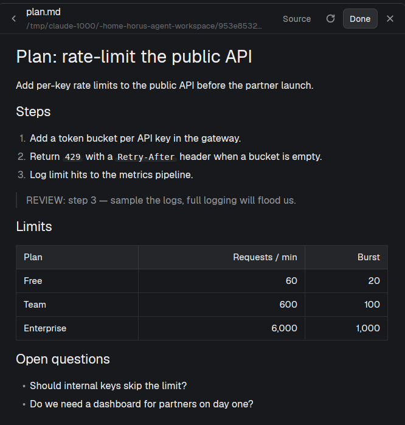

# Markdown review

A window for reviewing the plans, drafts and specs your agents write. The agent runs `md-review plan.md` and the file opens formatted over your terminals. You type your comments straight into it. When you click **Done**, the agent gets your changes back as a diff and carries on. `alt-m` opens the window yourself, and lists first the files the focused terminal has been talking about.

## Built on kanso's markdown panel

This is a remix of the markdown panel from [jlopezlira/herdr-kanso](https://github.com/jlopezlira/herdr-kanso/tree/main/markdown-panel) (Apache-2.0). Almost everything you see in the window is jlopezlira's work. You double-click a block to edit just that block while the rest stays formatted. Tables open as a grid of cells. It saves as you type, and it asks before it writes over a change the agent made in the meantime. It follows the file live, so you can watch a plan appear while the agent writes it. It is a carefully made panel, and its recipe is a pleasure to build from. If you only want to read and edit Markdown in herdr, install the original. This remix adds the way back to the agent: the Done button, `md-review`, and a list of the files your terminal mentioned.

## What you see

The original's window, unchanged, except:

- **Done**, in the header between Read again and Close, for a local file (not one on an SSH machine): 12 px text on `raised`, a 1 px `border` line, radius 6, 8 side padding, `hover` under the pointer, tooltip "Review done: tell the agent".
- **The list** (no file open) starts with "From this terminal" (11 px, `dim`): up to 15 rows, 30 tall, the file's name then its folder (`~/...` under your home). Under them, "In this folder" and the original's list of the folder's Markdown. With nothing from the terminal, only the folder's list shows, without headings.

## How it behaves

Everything the original does (editing, saving, conflicts, live follow, links, Source), plus:

- **md-review**: `md-review <file>` writes the file's absolute path to `data/md-review-open/<time>-<pid>.path` (under `appHome()`), opens the window with `herdr-app do mod.open '{"name":"md-review"}'` unless `herdr-app status` lists it already, and waits. The mod watches that folder, takes the newest path and opens it.
- **Done** saves first (as Close does), writes the file's path to `data/review-done/<time>-<pid>.path` and closes the window. `md-review` polls that folder every second; on a file holding its path it removes it, prints `Review done: <path>` and `diff -u` between the file as it was when the review started and now, and exits 0. Markers left for its path before it starts are removed, so an old click doesn't end a new review.
- **Escape** leaves the block being edited (it turns back into formatted text); with no block open it saves and closes the window.
- **From this terminal**: each time the window opens, `recent.sh <terminal>` (the focused pane's `hc` terminal) lists existing Markdown files, best first: a path on the clipboard (`wl-paste` or `pbpaste`), paths in `hc read <terminal>` from newest to oldest (`~` expanded), then the `*.md` files in the scratchpad of a Claude Code session in that terminal, newest first. A click opens one.
- **Outside herdr**: `md-review` exits 2 with "md-review: not running inside herdr; ask for the review in chat instead" when `HC_TERMINAL_ID` is unset.
- **Telling agents**: `md-review --rule` prints a short rule (`rule.md`) only inside herdr. As a Claude Code `SessionStart` hook it reaches Claude only in herdr terminals. opencode gets the rule in `~/.config/opencode/AGENTS.md`, because its commands may run in a server without herdr's environment; the "not running inside herdr" exit covers the rest. The rule tells the agent to run `md-review` in the background and treat the diff as review comments.

## Built from

- **The original**: build `mods/markdown-panel` from [its recipe](https://github.com/jlopezlira/herdr-kanso/blob/main/markdown-panel/RECIPE.md), without `markdown-handler.sh` (its macOS file handler), then name it `md-review`: the folder, icon paths (`mods/md-review/icons`), `mod.json` overlay `key`, and the inbox folder (`data/md-review-open`, so it never takes paths meant for kanso).
- **`mods/md-review/main.js`** changes, each marked "local addition":
  - `done(cx)` and the Done button;
  - Escape: `cx.bind_keys` in `init` with `escape` to the action `md_review_escape` in the contexts `MdReview` and `MdReview > Input`, the root marked `key_context("MdReview")` with `on_action("md_review_escape", …)`;
  - `findRecent(terminal, cx)` running `recent.sh` through `exec`, and the list with its two headings.
- **`mods/md-review/recent.sh`**: the "From this terminal" search (`sh`, `hc read`, `hc get --json`, `python3`, `~/.claude/sessions/<pid>.json` for the session id, `/tmp/claude-<uid>/*/<sessionId>/scratchpad`).
- **`bin/md-review`**, **`rule.md`**, **`install.sh`** (copies the mod, links `md-review` into `~/.local/bin`, binds `alt-m`, adds the hook and the opencode rule; safe to re-run).
- **One key**, in `keys.json`: `"global": { "alt-m": "mod.open:md-review" }`.

It runs programs (`sh`, `hc`, `python3`, `wl-paste`/`pbpaste`, through `exec`) and reads files outside its folder: the clipboard, the focused terminal's screen and history, `~/.claude/sessions/*.json` and Claude Code scratchpads. It writes only the file you edit and its own `data/` folders, and makes no network calls.

## Watch out

- A focused `Textarea` takes Escape before `on_key_down` sees it, so Escape is a key binding, not a key handler. A space-separated context (`MdReview Input`) doesn't parse; `MdReview > Input` does.
- Copy the mod into `mods/`, don't symlink it: herdr loads no icons from outside its home.
- Closing with × is not Done; the agent keeps waiting until Done is clicked on that file.
- A path the terminal wrapped across two screen lines isn't found on screen; the scratchpad list covers Claude Code's usual case.
- Files on an SSH machine stay read only and show no Done.
- Claude Code's scratchpad location and session files are undocumented and can change.

## Done when

- `herdr-app check mods/md-review` reports nothing.
- `md-review some.md` in a herdr terminal opens it in the window; editing a line and clicking Done makes `md-review` print a diff with that line and exit.
- Escape in an open block shows it formatted again; Escape again closes the window.
- With a `.md` path on the clipboard, `alt-m` lists it under "From this terminal"; in a Claude Code pane, its scratchpad's Markdown files are listed too.
- `md-review` with `HC_TERMINAL_ID` unset exits 2 with the "not running inside herdr" message, and `md-review --rule` prints nothing.
